# Отчет по заданию

Данные задания будут выполняться с помощью утилиты tcpdump

### Задание 1. Захват трафика и использование инструментов фильтрации в TCPDump/Windump

1.1 Запустить TCPDump или Windump в зависимости от платформы. Ознакомиться с встроенной справкой консольной утилиты.

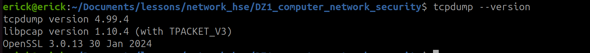


1.2 Идентифицировать интерфейс, с которого осуществляется доступ в Интернет. Выполнить захват трафика, убедиться, что захват происходит.


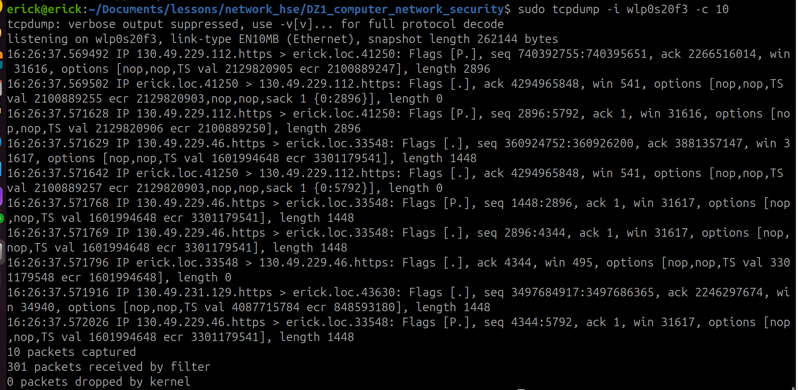

1.3 Настроить захват трафика с выводом в консоль следующим образом:

- детализация захвата -vv

- количество пакетов – 200

- не использовать разрешение имен DNS

- отображать заголовки Ethernet.

```bash
sudo tcpdump -i <имя_интерфейса> -vv -c 200 -n -e
```

1.4. Из дампа трафика, выявить MAC адреса компьютера и маршрутизатора (основного шлюза). Включить данные в отчет.

MAC адрес компьютера

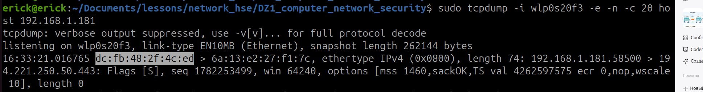

MAC адрес маршрутизатора

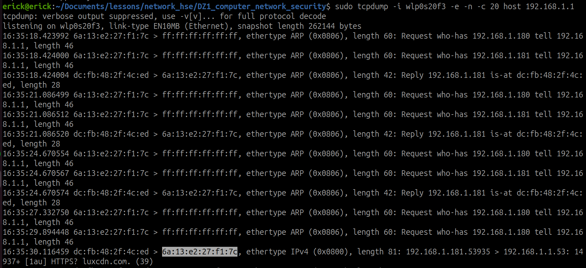


1.5. С помощью средств фильтрации трафика, захватить трафик, формируемый маршрутизатором. Сохранить дамп трафика в файл. Включить полученный файл в отчет.

```bash
sudo tcpdump -i wlp0s20f3 -n src host 192.168.1.1 -w router_dump.pcap
```

[router_dump.pcap](./router_dump.pcap)

1.6. С помощью средств фильтрации трафика выполнить захват ICMP пакетов (ping) на адрес 8.8.8.8. Сформировать трафик командой ping 8.8.8.8. Сохранить дамп трафика в файл. Включить полученный файл в отчет.

```bash
sudo tcpdump -i wlp0s20f3 -n icmp and host 8.8.8.8 -w ping_dump.pcap
```

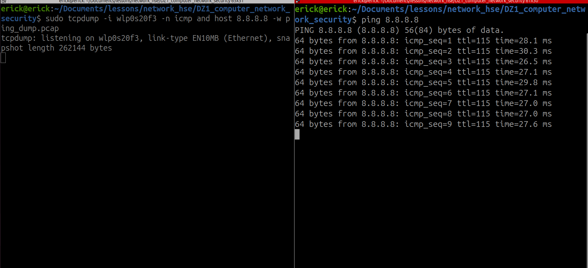

[ping_dump.pcap](./ping_dump.pcap)


### Задание 2. Захват трафика и использование инструментов фильтрации в Wireshark

2.1. Открыть файлы, сохраненные в Задании 1. Убедиться, что дамп трафика корректно отображается в Wireshark. Убедиться в совместимости форматов дампа. Закрыть файлы дампа.

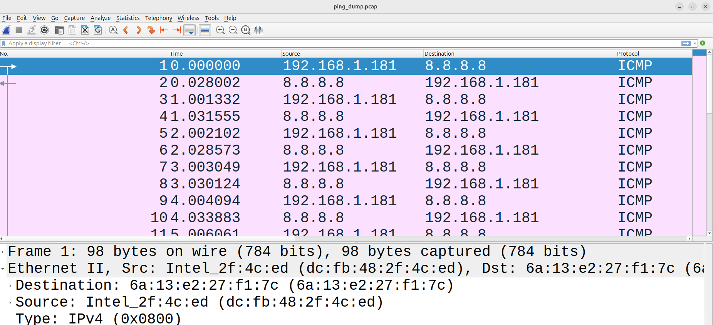

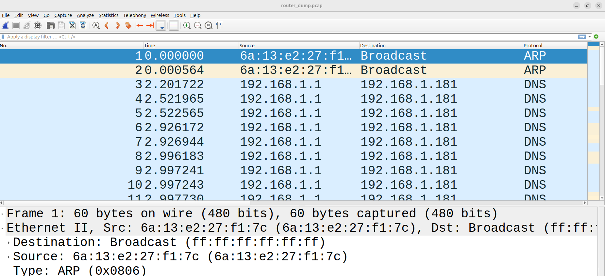

2.2. В Wireshark выбрать интерфейс ОС, с которого осуществляется доступ в Интернет. Запустить захват дампа трафика. Убедиться в наличии трафика на экране.

2.3. Создать фильтр захвата трафика, предусматривающий захват только трафика протоколов DNS и HTTPS. Установить размер дампа трафика в 50 пакетов.

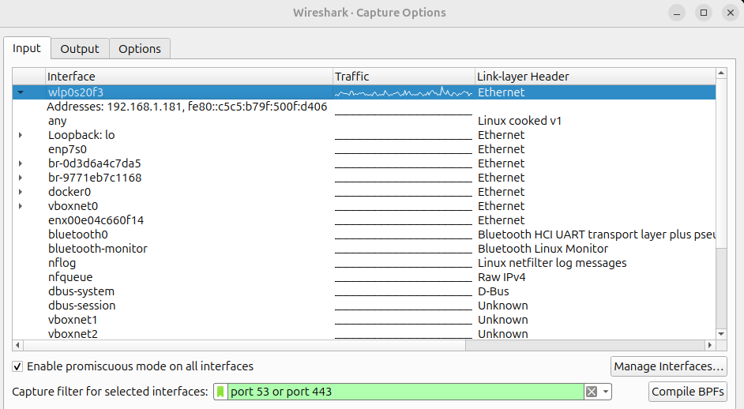

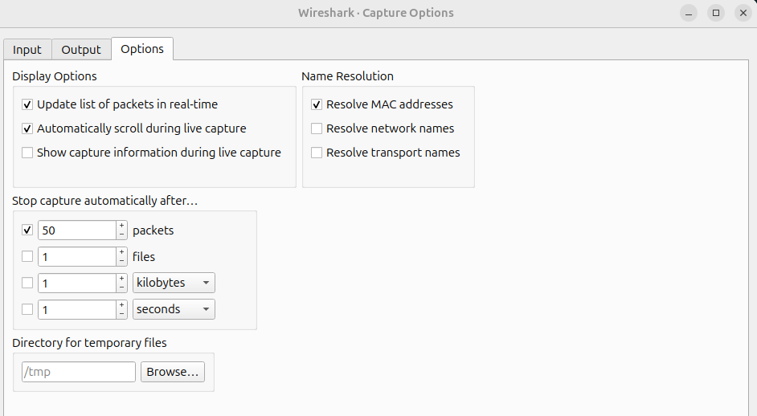

2.4. Использовать фильтр отображения пакетов в текущем дампе трафика. Отобразить только трафик, направленный от DNS сервера к клиенту. Сохранить весь дамп трафика в формате pcapng. Включить полученный файл и скриншот в отчет. 

Для того чтобы у меня появились DNS пакеты

```bash
nslookup ya.ru
```

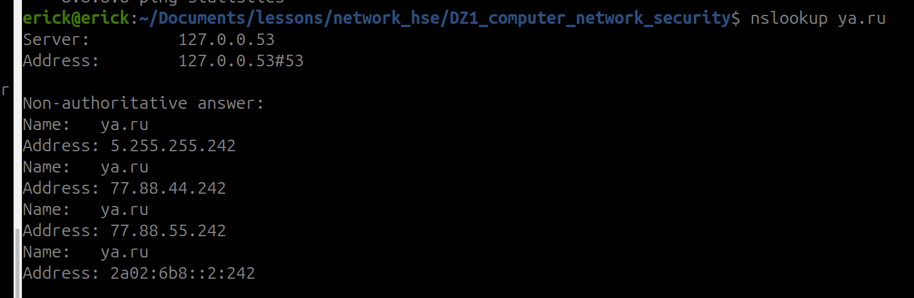

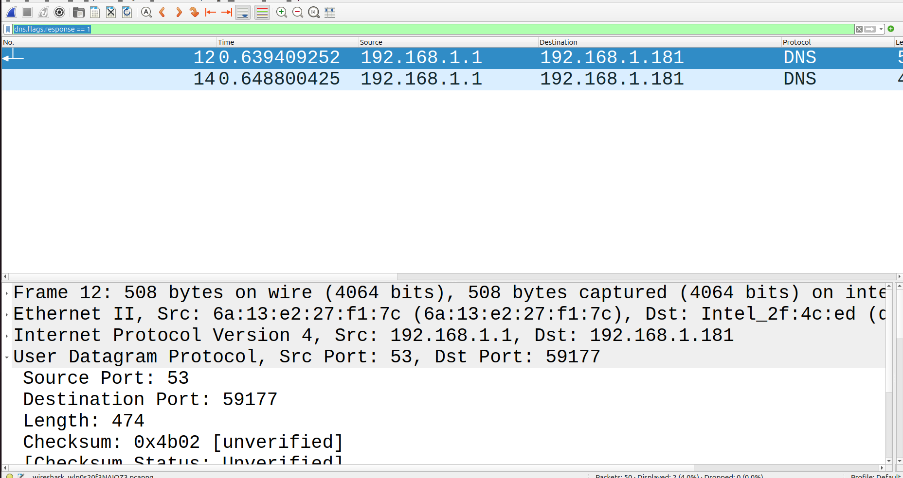

[dns_responses](./dns_responses.pcapng)