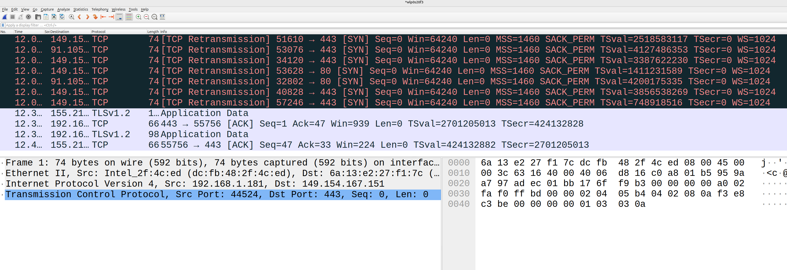
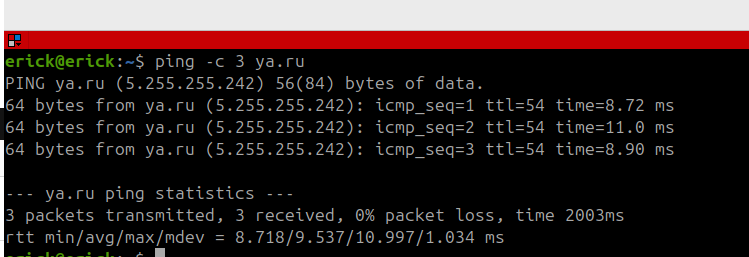
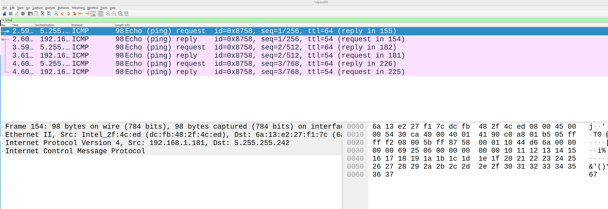
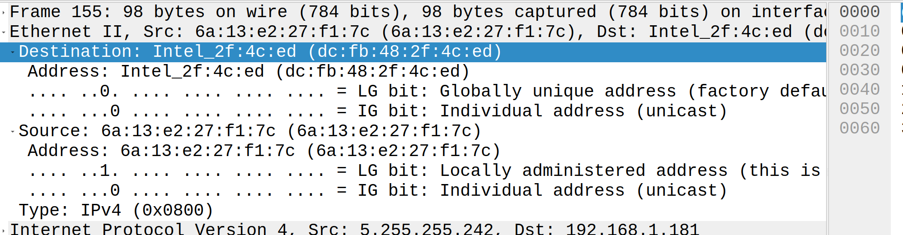
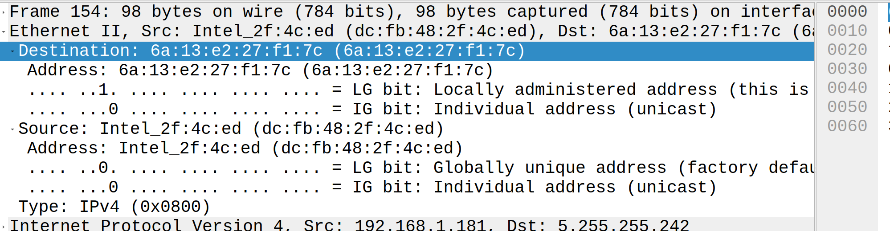
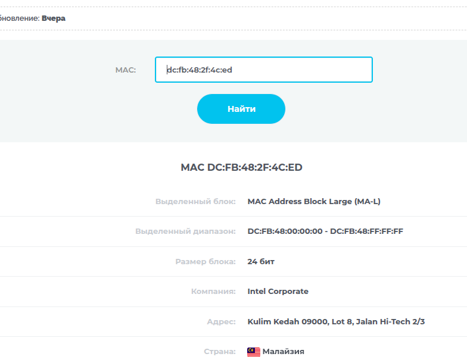
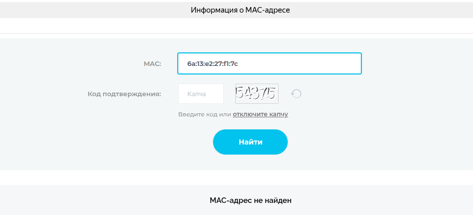
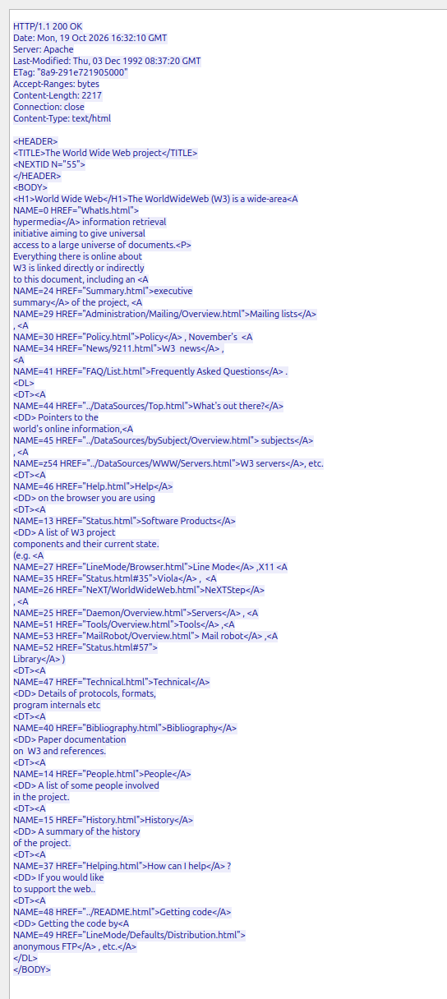

# Лабораторная работа №1


### Тема и цель работы

#### Тема лабораторной работы: 

«Знакомство с базовыми возможностями Wireshark».

#### Цель работы: 
приобретение навыков работы в интерфейсе командной
строки Windows/Linux, а также захвата сетевого трафика в сегменте локальной сети и анализа
собранной информации с помощью программного анализатора протоколов Wireshark..

### Обрудование


| Устройство | Операционная система | IP адрес / Маска | Шлюз | DNS |
| :--- | :--- | :--- | :--- | :--- |
| CLI | Ubuntu 24.04 | DHCP | - | - |

### Ход работы

1. Узнайте IP-адрес вашего компьютера с помощью утилиты ipconfig. Сделайте скриншоты
(и по итогу остальных пунктов). Лучше воспользуемся командой 

```
ip -br a | grep wlp0s20f3
```


2. Запустите Wireshark и разверните главное окно приложения на весь экран (для удобства
работы). Выбрать сетевой адаптер, на котором будет происходить мониторинг (Ethernet,
Беспроводная сеть и др. – в зависимости от способа вашего подключения).

Команда
```
sudo wireshark
```



3. Начать захват пакетов. Протестируйте подключение к серверу какого-либо известного
сайта с помощью утилиты ping. Измените количество запросов, например, до 3: ping -n 3
конечное_имя.




4. С помощью фильтра icmp найдите в WireShark перехваченные запросы (request) и ответы
(reply) утилиты ping. Совпадает ли количество ответов с количеством, полученным в п.3?
С помощью п.1. проанализируйте поля source (источник) и destination (получатель)
перехваченных кадров.

Исходя из скриншота - количество ответь и запросов совпадает



При reply



При request



Найдем наименование сетевых адаптеров по MAC-адресу

Мой сетевой адаптер



По MAC-адресу Yandex'a, скорее всенр виртуальный



4. По примеру, описанному в методических указаниях, откройте копию первого в мире
веб-сайта в браузере: http://info.cern.ch/hypertext/WWW/TheProject.html
Перехватите содержимое веб-страницы.

