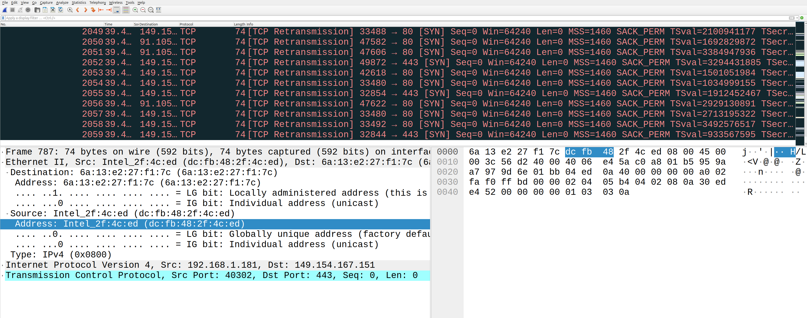
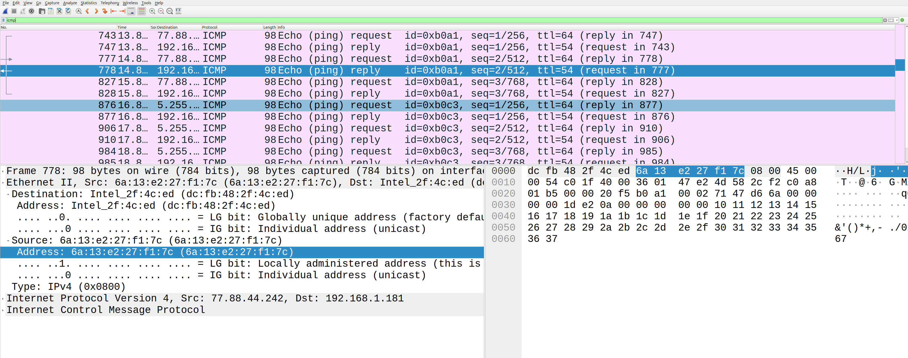
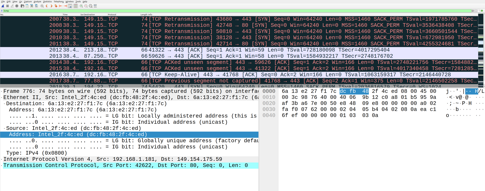
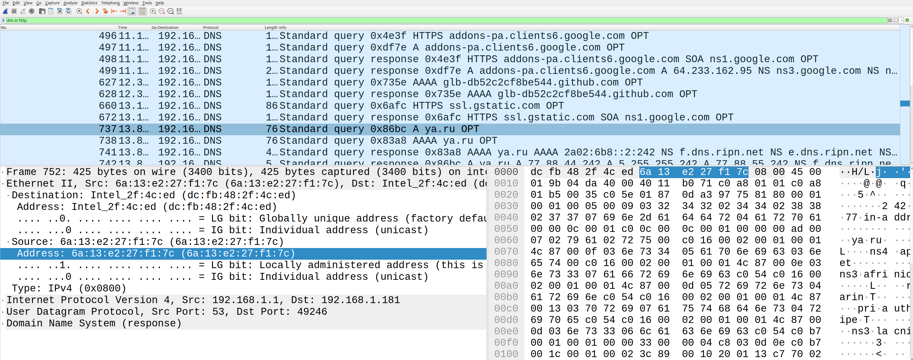
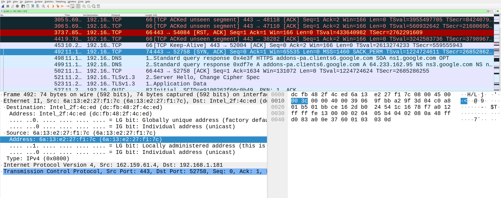
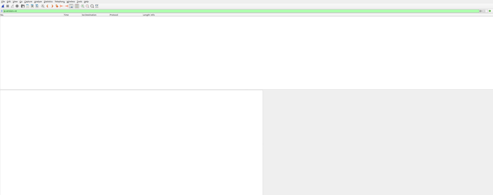
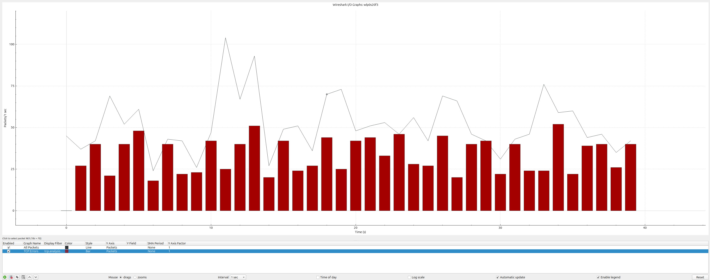

# Лабораторная работа №2.


#### Тема лабораторной работы: 

«Основы фильтрации трафика в Wireshark».

#### Цель работы: 

приобретение навыков фильтрации сетевого трафика в
сегменте локальной сети с помощью программного анализатора протоколов Wireshark

### Обрудование


| Устройство | Операционная система | IP адрес / Маска | Шлюз | DNS |
| :--- | :--- | :--- | :--- | :--- |
| CLI | Ubuntu 24.04 | DHCP | - | - |

### Ход работы

1. Открыть программу Wireshark, выбрать сетевой адаптер, на котором будет происходить
мониторинг (Ethernet, Беспроводная сеть – в зависимости от способа вашего подключения).

2. Захватить около 2000-3000 кадров, при этом пользуясь браузером для более скорого
сбора необходимого количества. Заскриньте результаты (это нужно делать и в следующих
пунктах)



3. Отобразите все кадры, кроме тех, которые используют в качестве протокола сетевого
уровня ICMP.

Если только ICMP



Если исключить ICMP



Можно вообще !icmp && !icmpv6, исключая пакеты по протоколу IPv6

4. Отобразите кадры, использующие либо протокол DNS, либо протокол HTTP.



5. Отобразите все кадры, где адрес назначения – IP-адрес Вашего компьютера.



6. Отобразите кадры, использующие протокол IP версии 6, с помощью команды
ip.version==6. Подумайте, с помощью еще какой команды можно сделать это?



Еще можно вот так

```
ipv6
```

7. Пользуясь графиком ввода-вывода, визуально выделить период (периоды) наибольшей
нагрузки, задать дисплейный фильтр и определить статистические показатели для этого
периода. Определить статистические показатели трафика, отразить график нагрузки сети. На
сколько увеличилась скорость захвата пакетов в этот период?



Максимальный пик: ~11 секунд (около 105 пакетов/сек)

Второй пик: ~14 секунд (около 90 пакетов/сек)


##  Итоговый отчет

| Показатель | Значение |
| :--- | :--- |
| Период пиковой нагрузки | 10–15 секунд |
| Максимальная скорость | ~105 пакетов/сек (на 11 сек) |
| Средняя скорость (фон) | ~45 пакетов/сек |
| Увеличение скорости | ~133% (в 2.3 раза) |
| Дисплейный фильтр | `frame.time_relative >= 10 and frame.time_relative <= 15` |

