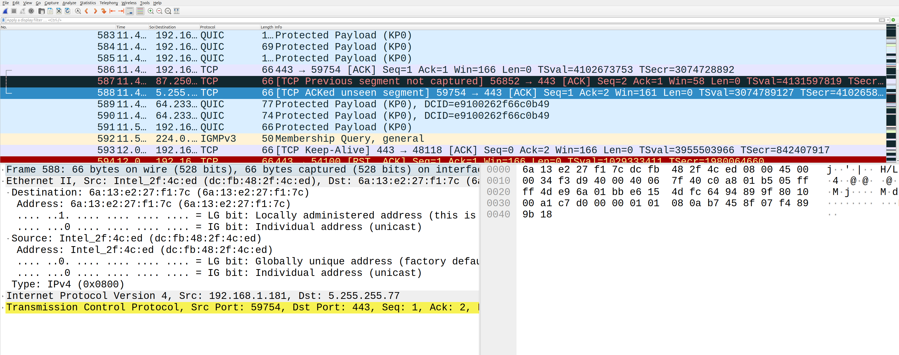
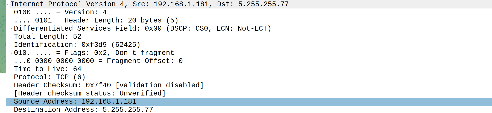

# Лабораторная работа №3.

### Тема и цель работы

#### Тема лабораторной работы: 

Инкапсуляция. Расшифровка полей заголовков канального и сетевого уровня в
Wireshark.

#### Цель работы: 

приобретение навыков расшифровки информации пакетов в
сегменте локальной сети с помощью программного анализатора протоколов Wireshark

### Обрудование

| Устройство | Операционная система | IP адрес / Маска | Шлюз | DNS |
| :--- | :--- | :--- | :--- | :--- |
| CLI | Ubuntu 24.04 | DHCP | - | - |

### Ход работы

1. Откройте программу Wireshark и начните захват кадров.
2. Прекратите захват кадров. Выделите один кадр, использующий как протокол
сетевого уровня IP версии 4 (т.е. не ARP, у которого своя структура пакета, и не
IPv6).
3. На панели декодера протоколов, нажимая указателем мыши на символ «>»,
отобразите информацию о полях заголовка канального уровня (Ethernet II) с
требуемым уровнем детализации. Скопируйте распечатку значений полей
(Копировать – Все видимые пункты выбранного дерева) в отчёт.

4. Пользуясь рисунком и методическими указаниями, проинтерпретируйте на русском
языке поля заголовков канального уровня.

## Интерпретация полей заголовка канального уровня (Ethernet II)

###  Общие поля кадра

| Поле | Значение | Интерпретация |
| :--- | :--- | :--- |
| **Ethernet II** | — | Тип кадра — Ethernet версии II (наиболее распространённый стандарт IEEE 802.3) |
| **Type** | `IPv4 (0x0800)` | Поле типа указывает, какой протокол сетевого уровня инкапсулирован в кадре. Значение `0x0800` означает **IPv4** |

---

### Адрес назначения (Destination)

| Поле | Значение | Интерпретация |
| :--- | :--- | :--- |
| **Destination** | `6a:13:e2:27:f1:7c` | MAC-адрес получателя кадра |
| **LG bit** | `1` — Locally administered address | Бит **L/G** = 1 означает, что адрес **локально администрируемый** (не заводской, назначен вручную или программно) |
| **IG bit** | `0` — Individual address (unicast) | Бит **I/G** = 0 означает **индивидуальный адрес** — кадр предназначен одному конкретному узлу (**unicast**), а не группе (multicast) или всем (broadcast) |

>  адрес назначения `6a:13:e2:27:f1:7c` — локально назначенный unicast-адрес. Первый байт `6a` в двоичном виде: `0110 1010`. Младший бит первого октета = 0 (unicast), второй младший бит = 1 (locally administered).

---

###  Адрес источника (Source)

| Поле | Значение | Интерпретация |
| :--- | :--- | :--- |
| **Source** | `Intel_2f:4c:ed (dc:fb:48:2f:4c:ed)` | MAC-адрес отправителя. Префикс `dc:fb:48` принадлежит компании **Intel Corporation** (Wireshark автоматически распознаёт производителя по OUI) |
| **LG bit** | `0` — Globally unique address (factory default) | Бит **L/G** = 0 означает **глобально уникальный адрес** — заводской, назначенный производителем оборудования |
| **IG bit** | `0` — Individual address (unicast) | Бит **I/G** = 0 означает **индивидуальный адрес** (unicast) — кадр отправлен одним конкретным узлом |

5. На панели декодера протоколов, нажимая указателем мыши на символы «>»,
отобразите информацию о полях заголовка сетевого уровня (Internet Protocol version 4) с требуемым уровнем детализации. Скопируйте распечатку значений полей
(Копировать – Все видимые пункты выбранного дерева) в отчёт.

6. Пользуясь рисунком и методическими указаниями, проинтерпретируйте на русском
языке поля заголовков сетевого уровня.

## Интерпретация полей заголовка сетевого уровня (IPv4)

###  Общие поля заголовка

| Поле | Значение | Интерпретация |
| :--- | :--- | :--- |
| **Version** | `4` (`0100`) | Версия протокола IP. Значение **4** означает **IPv4** (четвёртая версия интернет-протокола) |
| **Header Length** | `20 bytes (5)` | Длина заголовка IP-пакета — **20 байт** (5 слов по 32 бита). Это минимальная длина заголовка IPv4 без дополнительных опций |
| **Differentiated Services Field** | `0x00 (DSCP: CS0, ECN: Not-ECT)` | Поле дифференцированного обслуживания: **DSCP = CS0** (обычный приоритет, best-effort), **ECN = Not-ECT** (узел не поддерживает явное уведомление о перегрузках) |
| **Total Length** | `52` | Общая длина IP-пакета (заголовок + данные) — **52 байта**. Из них 20 байт — заголовок, 32 байта — данные (полезная нагрузка) |

---

###  Идентификация и фрагментация

| Поле | Значение | Интерпретация |
| :--- | :--- | :--- |
| **Identification** | `0xf3d9 (62425)` | Идентификатор пакета — **62425**. Используется для сборки фрагментов: все фрагменты одного исходного пакета имеют одинаковое значение этого поля |
| **Flags** | `0x2, Don't fragment` | Флаги фрагментации: установлен флаг **DF (Don't Fragment)** — пакет **запрещено фрагментировать**. Если маршрут требует фрагментации, пакет будет отброшен с отправкой ICMP-сообщения |
| **Fragment Offset** | `0` | Смещение фрагмента — **0**. Пакет не является фрагментом (или это первый фрагмент). Поскольку DF=1, это целый (нефрагментированный) пакет |

---

###  Параметры доставки

| Поле | Значение | Интерпретация |
| :--- | :--- | :--- |
| **Time to Live (TTL)** | `64` | Время жизни пакета — **64** перехода (хопа). Каждый маршрутизатор уменьшает TTL на 1. При достижении 0 пакет отбрасывается. Значение 64 типично для **Linux/Unix-систем** (в Windows обычно 128) |
| **Protocol** | `TCP (6)` | Протокол транспортного уровня, инкапсулированный в IP-пакете — **TCP** (номер 6). Другие примеры: UDP=17, ICMP=1 |
| **Header Checksum** | `0x7f40 [validation disabled]` | Контрольная сумма заголовка IP — `0x7f40`. Статус **Unverified** означает, что Wireshark не проверял её (обычно из-за offloading на сетевую карту) |

---

###  Адреса

| Поле | Значение | Интерпретация |
| :--- | :--- | :--- |
| **Source Address** | `192.168.1.181` | IP-адрес отправителя — **192.168.1.181**. Это адрес из частной сети (RFC 1918), диапазон `192.168.0.0/16` — ваша локальная сеть |
| **Destination Address** | `5.255.255.77` | IP-адрес получателя — **5.255.255.77**. Это публичный IP-адрес, принадлежащий диапазону `5.0.0.0/8` (выделен RIPE NCC, часто используется в Европе/России) |

###  Сводная таблица

| Поле | Значение | Смысл |
| :--- | :--- | :--- |
| Version | 4 | IPv4 |
| Header Length | 20 байт | Минимальный заголовок, без опций |
| DSCP / ECN | CS0 / Not-ECT | Обычный приоритет, без ECN |
| Total Length | 52 байта | 20 байт заголовок + 32 байта данных (TCP-сегмент) |
| Identification | 62425 | Идентификатор для сборки фрагментов |
| Flags | DF (Don't Fragment) | Фрагментация запрещена |
| Fragment Offset | 0 | Не фрагментирован |
| TTL | 64 | Осталось 64 перехода (типично для Linux) |
| Protocol | TCP (6) | Транспортный протокол — TCP |
| Header Checksum | 0x7f40 | Контрольная сумма заголовка |
| Source Address | 192.168.1.181 | Ваш локальный IP-адрес |
| Destination Address | 5.255.255.77 | Публичный IP-адрес получателя |

