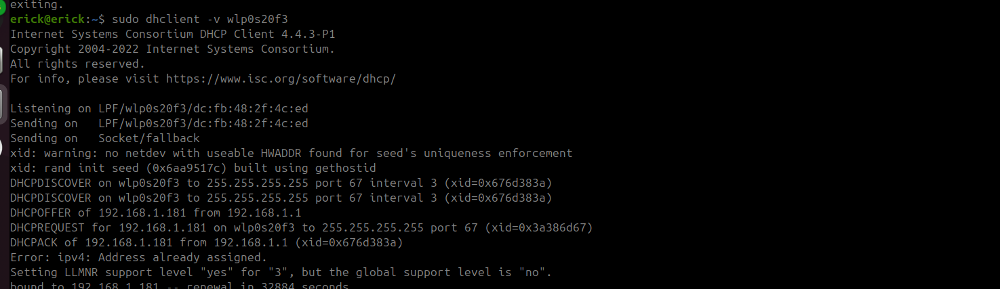
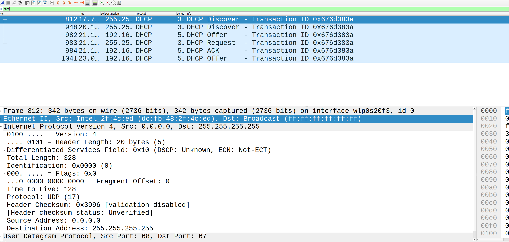

# Лабораторная работа №4.

### Тема и цель работы

#### Тема лабораторной работы: 

Протокол DHCP. Процесс назначения IP-адресов

#### Цель работы: 

изучить работу протокола DHCP в
сегменте локальной сети с помощью программного анализатора протоколов Wireshark

### Обрудование

| Устройство | Операционная система | IP адрес / Маска | Шлюз | DNS |
| :--- | :--- | :--- | :--- | :--- |
| CLI | Ubuntu 24.04 | DHCP | - | - |

### Ход работы

1. Откройте Wireshark и начните захват кадров.
2. Освободите уже занятый вами IP-адрес с помощью команды ipconfig /release
<interface> (sudo dhclient -r <interface> в Linux, ipconfig set <interface> BOOTP в
MAC)
3. Запросите у DHCP-сервера IP-адрес еще раз с помощью команды ipconfig /renew
(sudo dhclient <interface> в Linux, ipconfig set <interface> DHCP в MAC)

4. Остановите захват кадров. Выделите нужные кадры с помощью фильтра dhcp.

5. Проинтерпретируйте пакет DHCPOFFER: каков IP-адрес DHCP-сервера вашей
сети? Каковы параметры, которые предлагает вашему устройству DHCP-сервер
на втором шаге?

### 1. IP-адрес DHCP-сервера
| Параметр | Значение | Где указано в пакете |
| :--- | :--- | :--- |
| **IP-адрес DHCP-сервера** | `192.168.1.1` | Заголовок IP (`Src: 192.168.1.1`), порт UDP `67`, а также **Option (54)** DHCP Server Identifier |

---

### 2. Параметры, предлагаемые вашему устройству
| Параметр сети | Значение | Номер опции DHCP | Описание |
| :--- | :--- | :---: | :--- |
| **Предлагаемый IP-адрес** (Your IP) | `192.168.1.181` | *(Основное поле пакета)* | Адрес, который сервер выделяет вашему устройству |
| **Маска подсети** (Subnet Mask) | `255.255.255.0` | Option (1) | Определяет размер локальной сети (в данном случае /24) |
| **Шлюз по умолчанию** (Router) | `192.168.1.1` | Option (3) | IP-адрес роутера, через который идет выход в интернет |
| **DNS-сервер** (Domain Name Server)| `192.168.1.1` | Option (6) | Сервер, преобразующий доменные имена в IP-адреса (здесь это сам роутер) |
| **Время аренды** (Lease Time) | ~28 981 день | Option (51) | Срок, на который выдается IP-адрес (фактически "бессрочно") |
| **Доменное имя** (Domain Name) | `loc` | Option (15) | Локальный суффикс домена для вашей сети |
| **Имя хоста** (Host Name) | `erick` | Option (12) | Имя вашего устройства, которое сервер принял и запомнил |
| **Информация о вендоре** (Vendor class)| `Realtek CPE E8ROUTER 1.0`| Option (60) | Указывает на модель/прошивку роутера (абонентский терминал на чипе Realtek) |
