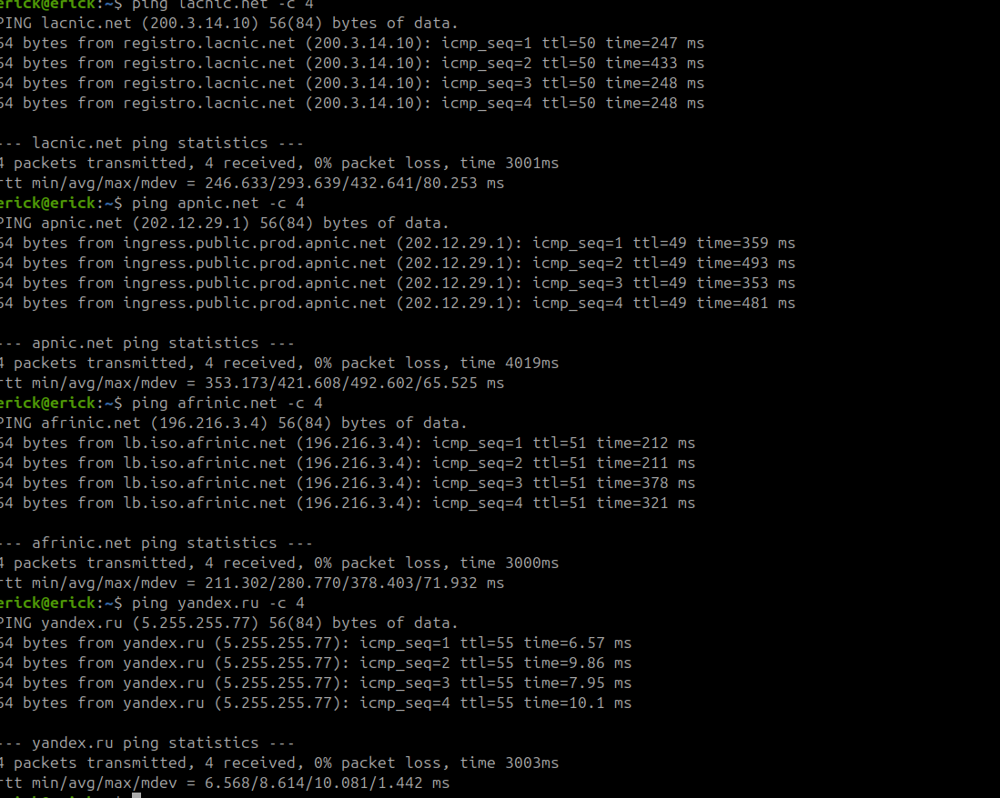
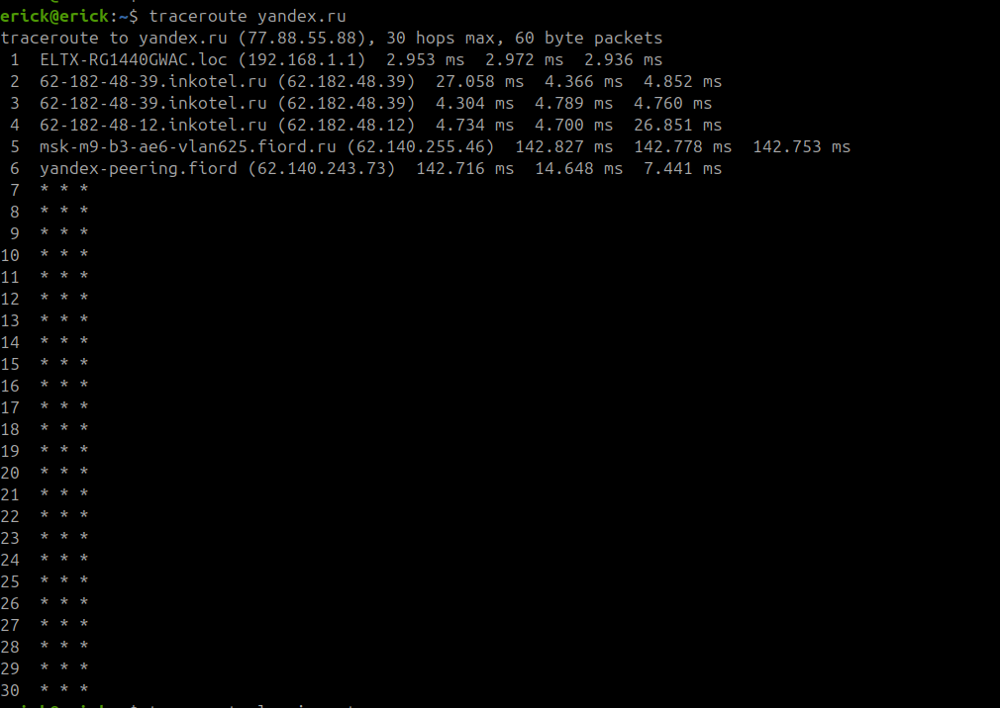
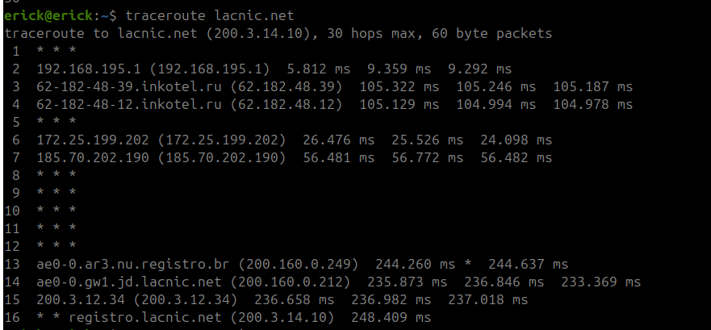
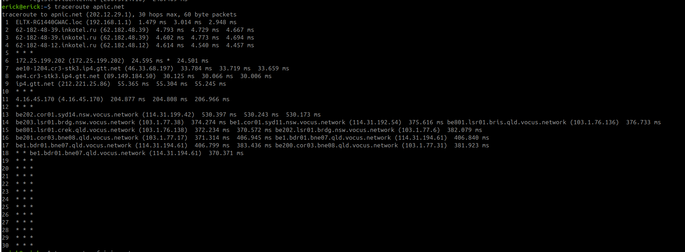
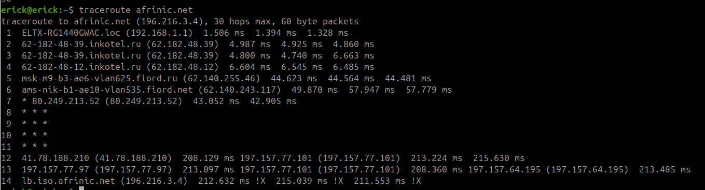
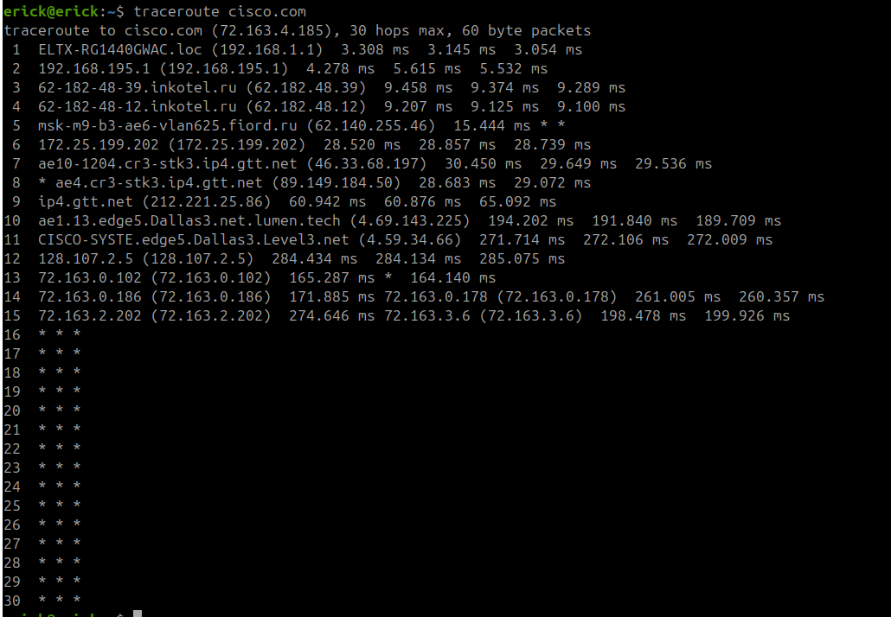
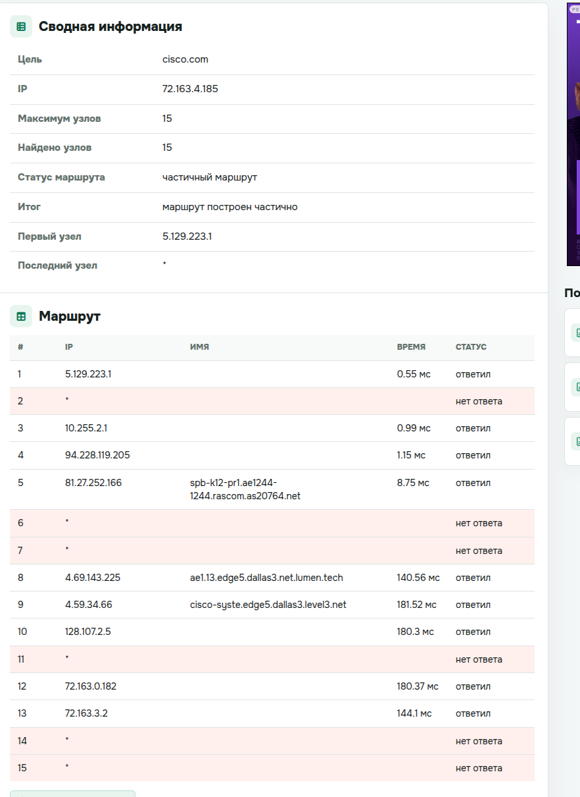
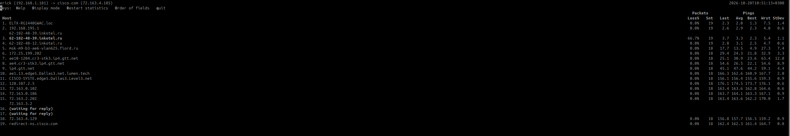

# Лабораторная работа №4.

### Тема и цель работы

#### Тема лабораторной работы: 

Визуализация Интернета. Утилиты ping и traceroute

#### Цель работы: 

изучить работу утилит ping и traceroute

### Обрудование

| Устройство | Операционная система | IP адрес / Маска | Шлюз | DNS |
| :--- | :--- | :--- | :--- | :--- |
| CLI | Ubuntu 24.04 | DHCP | - | - |

### Ход работы
1. Проверьте соединение с узлами lacnic.net, apnic.net, afrinic.net, yandex.ru с помощью
команды ping. Что происходит со средним временем ping в миллисекундах, когда данные
передаются в пределах одного континента по сравнению с данными, передающимися по
разным континентам?

Среднее время ping (сетевая задержка) значительно ниже при передаче данных в пределах одного континента по сравнению с передачей между разными континентами.
Это фундаментальное ограничение, обусловленное законами физики и архитектурой глобальной сети. Вот детальное сравнение и причины:

- Физическое расстояние и скорость света (различные задержки, например у оптоволоконных линий связи по документации есть задержка на 1 км линии, так же задержки на спайках и на приемниках, передаьчиках)
- Подводные магистральные кабели
- Количество сетевых узлов (Hops)
- Сложность маршрутизации и пиринг

2. Проверьте соединение с узлами lacnic.net, apnic.net, afrinic.net yandex.ru с помощью
команды tracert. К какому из рассмотренных узлов необходимо было сделать максимальное
количество прыжков? Минимальное?

Минимальный

afrinic.net — 14 прыжков

Максимальный

lacnic.net — 16 прыжков.

Не достигли узлов

apnic.net и yandex.ru — оба показали 30

3. Сравнение результатов трассировки.
Сравните результаты трассировки для cisco.com с помощью командной строки,
веб-ресурс и программы OpenVisualTraceroute. Чем отличается трассировка для cisco.com из
командной строки и с использованием веб-инструментов? Чем отличалась трассировка с
помощью программного обеспечения? Все ли утилиты трассировки использовали один и тот
же путь к www.cisco.com?

Так как все подобные утилиты устарели типа OpenVisualTraceroute на Ubuntu24.04, то воспользуюсь встроенной утилитой mtr

## Сравнение трассировок cisco.com

| Характеристика | Командная строка (traceroute) | Веб-инструмент | MTR |
|----------------|-------------------------------|----------------|-----|
| **Источник** | Ваш ПК (192.168.1.181) | Удалённый сервер (5.129.223.1) | Ваш ПК (192.168.1.181) |
| **Первый узел** | 192.168.1.1 (ваш роутер) | 5.129.223.1 | ELTX-RG1440GWAC.loc |
| **Путь** | Через inkotel.ru → fiord.ru → gtt.net | Через rascom.as20764.net → lumen.tech | Через inkotel.ru → fiord.ru → gtt.net |
| **Достигнуто узлов** | 15 из 30 | 15 (частичный маршрут) | 19 |
| **Статистика** | 3 замера на узел | 1 замер на узел | Непрерывная статистика |

Чем отличается трассировка для cisco.com из
командной строки и с использованием веб-инструментов?

- traceroute начинается с вашей локальной сети (192.168.1.1)
- Веб-инструмент начинает трассировку с сервера провайдера (5.129.223.1), который находится в другой сети.

Чем отличалась трассировка с
помощью программного обеспечения?

MTR показал более полную картину:
- MTR отправляет пакеты постоянно (19 пакетов на узел в вашем случае).
- Показал 66.7% потерь на узле 3 (62-182-48-39.inkotel.ru) — это проблема, которую обычный traceroute не выявил бы.

Все ли утилиты трассировки использовали один и тот же путь к www.cisco.com?

Как видим на скриншотах - нет